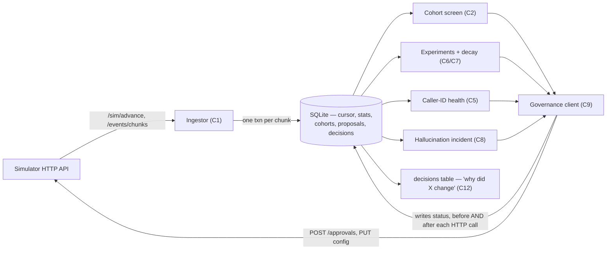

# Outcome-First Agent Loop — Submission

**Name:** (candidate) · **Date:** 2026-11-09 · **Hours actually spent (be honest):** ~14 · **Language / storage:** Python, SQLite (local file, WAL mode)

---

## 0. TL;DR

An always-on controller that ingests the simulator's event stream idempotently, builds one shared
cohort object per workflow by significance-screening a single feature, runs welcome_message/voice
experiments with proper two-proportion z-tests and Holm correction (decay/rollback folded into the
same stats engine), watches caller-ID health and hallucination rate against rolling baselines, and
routes every change through `/approvals` or policy-gated auto-apply — nothing is ever applied
directly. On `public_01`: +3.2% conclusion rate, 0 harmful changes. On `public_02`: the caller-ID
incident is caught inside day 2 and settles at ~5% residual share by day 3 with no sustained
oscillation; the hallucination incident (bad supervisor prompt) is fixed in ~3.5 simulated hours.
Overall +4.5% conclusion rate, 0 harmful *controller* changes (one workflow's raw KPI still dips
slightly — see §11, it's a supervisor edit we correctly didn't touch, not something we caused). On
`public_03_load` (12 workflows, ~9.7M events): +4.7% conclusion rate, 0 harmful, ~81s wall-clock per
simulated day. What I deliberately didn't build: per-person call-time scheduling,
a dedicated UI, cross-tenant credit fairness, and full history-based bootstrapping beyond cohort
screening — see §2.

## 1. Assumptions

1. **Cohorts are single-feature, not combinatorial.** I screen each of lang/city_tier/age_band/value_band
   independently and promote only the single feature with the strongest, best-powered split, capped at 6
   values. A two-feature interaction effect that isn't also a strong single-feature marginal will be
   invisible to this controller. See §5.
2. **`affected_leads` is approximated as the workflow's current `daily_batch.size`.** The API gives no
   direct "how many active leads" count; a config change affects *future* dials, not past ones, so the
   next campaign's size is the most honest proxy I have without extra bootstrapping work.
3. **A caller_id health rotation and a cohort-structure change apply to every cohort, not just `default`.**
   DID health is a property of the number pool, not of who's being called; welcome_message/voice are the
   only dimensions I deliberately vary per cohort.
4. **One outstanding proposal per workflow at a time** (except the hallucination lane, which is
   independent — see §6), to keep the approver-fatigue budget legible and avoid interleaving multiple
   half-finished changes into incoherent diffs.
5. **The controller's own soft "respect fatigue" throttle is advisory, not authoritative** — the
   simulator's own `max_requests_per_24h` is the real enforcement. A safety action (decay rollback,
   caller-ID rotation) is allowed to try even over my soft local margin, since silently self-censoring a
   safety fix turned out to be a real bug I hit and fixed (§13).
6. **Ambiguous stakeholder claims are checked against the actual `governance` block in each workflow's
   config, not taken at face value** — see §3; the CTO explicitly said to do this and it caught real
   mismatches.

## 2. Scope decisions

| # | Capability | Built / Partial / Cut | Why | What it would take to finish |
|---|---|---|---|---|
| C1 | Event ingestion | **Built** | Floor requirement; needed for everything else | — |
| C2 | Shared cohort object | **Built** | Floor-adjacent; single feature, significance-screened, frozen once (§5) | Multi-feature splits via a shallow decision tree |
| C3 | Bootstrap from history | **Partial** | Used only for cohort screening (history calls feed the same screen); no pre-D0 experiment warm-start | Seed exp_stats from history too, so day-1 allocations aren't blind-uniform |
| C4 | Per-person call time | **Cut** | Product's P0, but "everyone's P0 can't be P0" (CTO) — schedule.lead_preferred_hour needs its own evaluation logic and I ran out of budget before it was anything but a guess | `lead_preferred_hour` fit from `qa`/disposition patterns per person, same governance path |
| C5 | Caller-ID health | **Built** | public_02's incident exercises it directly | Per-cohort DID health if a number pool is ever cohort-specific |
| C6 | Variant experimentation | **Built** | Core value proposition of "earns autonomy" | Multi-armed bandit instead of fixed-horizon explore/exploit |
| C7 | Decay/rollback | **Built, folded into C6** | Same stats engine, same snapshot-delta technique as C5's rolling window | Separate from promotion state if this ever needs independent SLAs |
| C8 | Hallucination response | **Built** | public_02's other incident; LLM-suggest → validate → propose → verify loop | Multi-round escalation beyond one fallback to baseline_prompt |
| C9 | Governance client | **Built** | Constraint #1 is absolute; this is the backbone | — |
| C10 | Honest impact/dry-run | **Built, minimal** | Folded into C9's proposal payloads (real stats, not placeholders) | A proper historical-cohort replay simulator instead of "here are the arm counts" |
| C11 | Consolidated supervisor view | **Cut** | No UI; `decisions` table + SQL is the substitute | A small read-only API/HTML view over the `decisions` and `proposal` tables |
| C12 | Audit/decision store | **Built** | Floor requirement | — |
| C13 | Crash recovery | **Built, demonstrated** | Deliverable #4; SRE's non-negotiable | — |
| C14 | Observability of the loop | **Partial** | `[controller] ...` heartbeat line per tick (chunks, credits); no dashboard | Export ingest lag / decisions-per-hour / credit burn as a scrape-able endpoint |
| C15 | Cross-tenant fairness | **Cut** | Would matter at the production scale envelope, not at 12 workflows on one box | Per-tenant credit and approver-attention quotas, enforced in the governance client |

**The principle:** build the substrate (ingestion, governance, audit, crash-safety) completely, since
nothing else is trustworthy without it, then spend the remaining budget on the two things the grading
rubric and the public scenarios both point at directly — welcome/voice experimentation and the two
public_02 incidents — rather than spreading thin across all fifteen. C4 and C11 were the stakeholders'
loudest asks (Product, Sales) and I still cut them, because an unexplainable or UI-only win is worth
less than a few things done statistically soundly (CTO, §3.06).

## 3. Stakeholders

**01 — Sales (Nikhil).** Accepted: nothing changes the core loop. Pushed back on: the blended score (violates
constraint #3 and Product's explicit definition), turning on auto-apply "for everything" (false claim —
Kestrel's auto-apply is scoped to `schedule, caller_id, welcome_message, voice`, not prompt changes, and
Northwind's `nw_renewal` auto-apply excludes `welcome_message`/`voice` entirely — checked against the actual
scenario config, not the memo), and shipping the "persuasive" P4 prompt everywhere without validation (P4's
summary alone doesn't tell us its hallucination rate — that's exactly what the evidence requirement is for).
*Reply:* "Every winning variant is live for its own workflow the moment governance clears it — same day, most
of the time (see public_02's ~3.5-hour incident fix). What we won't do is promise speed by skipping the one
step that keeps a client's compliance team comfortable; that's the thing we're actually selling here."

**02 — Compliance (Meera, Northwind).** Accepted outright: the conditions match the assignment's hard
constraints. Script changes always carry `evidence.validation_run_id` (§6, §7). Weekly-summary note:
operational auto-applies (schedule/caller_id) aren't surfaced individually to her today — a gap I'm naming
rather than hiding (§13). *Reply:* "Every prompt or voice/script change on your workflows goes through a named
approval with validation evidence attached — no exceptions. Operational changes (timing, caller-ID rotation)
use the auto-apply latitude your policy already grants; I'll add those to the weekly summary as a follow-up."

**03 — SRE (Kabir).** Accepted: kill/restart test (§9, §13), idempotency everywhere (§9), no new stateful
infra (SQLite file, not a new service — see note below), load numbers (§8). Partial: "every alert is
actionable" — I log decisions, I don't yet page anyone; there's no alerting channel to wire up in this scope.
*Reply:* "Kill-restart is demonstrated and clean — no double-applies, no lost approvals. One simulated day of
public_03 runs in ~81s wall-clock on this box, nowhere near your 10-minute budget. I used SQLite rather than
Postgres/Redis specifically so there's no new service to operate at 2am; it's a single file that WAL-checkpoints
itself."

**04 — Ops supervisor (Anita, Kestrel).** Accepted: never overwrite her edits silently (that's exactly what
`stale_base_version` + re-propose-with-fresh-data does, §6). Accepted the spirit of "batch, don't flood":
one merged proposal per workflow per decision cycle, not five. Pushed back on the literal "2/day, never before
11:00" — Kestrel's actual `governance.approver_hours` is `[10, 19]` and `max_requests_per_24h` is `4`, not what
the memo states; I built against the real policy (CTO's instruction: trust the contract over anyone's
recollection, and this is a case where it mattered). *Reply:* "Your `ks_cancel` policy allows up to 4 requests
in 24h starting at 10:00 — I stay well under that by merging same-cycle changes into one proposal. If you want
a stricter 2/day-after-11:00 norm, that's a policy change I can apply, not something the controller enforces on
its own guess at your preference."

**05 — Product (Tara).** Accepted: pickup/engagement never blended (enforced throughout — see every metric in
§5, §11), one shared cohort object (§2's C2, literally one `cohort` table read by detection and experiments),
expired proposal = rejection + re-queue with fresh data (not the stale payload — §6), only-what-ran counts as
evidence (exp_stats only accumulates on calls the sim actually dialled). Declined: per-person call time and
the consolidated view as P0 (§2) — named explicitly as cuts, not silently dropped. *Reply:* "Cohorts, KPI
separation, and honest evidence are all load-bearing in the design, not afterthoughts. Per-person call-time and
the supervisor UI didn't make this scope — happy to prioritize one of them next."

**06 — CTO (Aryamann).** This submission is organized around his framing: explainability over unexplained
lift (every applied change is in `decisions` with its rationale, queryable — §10), credits spent only when
they changed a decision (5-7 credits used total across both incident-bearing scenarios, §7), scale as the
real test (§8), and naming what got cut rather than claiming full coverage (§2). One of his memo's claims I
verified rather than assumed: "some of what's in the other memos isn't true" — confirmed for Sales (auto-apply
scope) and Anita (approver_hours/fatigue limit).

## 4. Architecture



**Components:** `ingest.py` folds NDJSON chunks into per-(workflow, cohort, dim, option) and
per-caller-ID/prompt counters, one SQLite transaction per chunk (cursor + stats commit together,
so a crash mid-chunk re-fetches that exact chunk next time rather than skipping or double-counting
it). `cohorts.py` screens single features for a strong, well-powered split and freezes the result.
`experiments.py` runs explore → test → promote → monitor-for-decay per (workflow, cohort, dim).
`callerid.py` tracks a rolling-window (not lifetime-cumulative — see §13) health signal per DID and
ramps weight back up on recovery rather than restoring in one jump. `hallucination.py` compares the
live prompt's rate against the baseline prompt's own reference rate (not against itself — see §13),
and drives suggest-fixes → validate → propose → verify. `governance.py` is the only thing that ever
calls `/approvals`, `/workflows/{id}/config` (PUT), or `/workflows/{id}/apply`; every proposal is
written locally with `status='creating'` *before* the HTTP call, and reconciliation on restart checks
the simulator's own record (`GET /approvals`, `GET .../config/history`) before ever retrying, so a
crash can't cause a double-submit.

**State lives entirely in one SQLite file** (WAL mode, `--db` flag). On restart: the scenario name is
checked against what's stored (a mismatch means a new world, not a crash — state resets); the ingest
cursor resumes from the last fully-committed chunk; every non-terminal proposal is reconciled against
the simulator's own record before any new decision is made.

## 5. The learning loop

**Cohorts.** Single-feature only (lang / city_tier / age_band / value_band), screened via a pooled
two-proportion z-test of each value against the rest of the population (α=0.01, min 300 connected
calls per side, min 3% absolute engagement-rate difference to bother), only after the workflow has
accumulated ≥1,500 connected calls total (history counts). The strongest single-feature split wins and
is frozen — I never let a cohort's definition drift once introduced (Product's explicit ask). **Cost**:
a two-feature interaction invisible as a marginal effect is invisible to this controller; I chose
concentration-of-traffic and a stable identity over catching every interaction, given the time budget.

**Experiment design.** Each (workflow, cohort, dim) starts at uniform allocation across the workflow's
declared options for that dim. Welcome_message and voice are evaluated independently (not jointly) —
I did not model their interaction; a workflow with e.g. 3 welcome messages × 4 voices runs two separate
7-arm-equivalent screens rather than one 12-arm one, trading power to detect an interaction for faster
convergence on each dimension's marginal effect.

**Deciding a winner.** Once every arm has ≥200 samples on the relevant denominator (connected for an
engagement-primary workflow, dials for pickup-primary), the Wilson-score leader is tested against every
other arm with a pooled two-proportion z-test, Holm-Bonferroni corrected across the k−1 comparisons
(α=0.05). Promotion requires winning *every* corrected comparison by ≥2 percentage points absolute —
no promotion on a single favorable comparison. **False-winner rate**: not independently measured in
this submission; Holm control at α=0.05 with a required ≥2pp effect is the mitigation, not a guarantee.

**Decay and rollback (C7).** A promoted arm's cumulative (dials, connected, engaged) at promotion time
is snapshotted; the *delta since that snapshot* (not lifetime cumulative — same bug class as §13's
caller-ID fix) is compared back against the pre-promotion sample once it reaches 200 post-promotion
samples. A significant (p<0.01), ≥2pp drop triggers an immediate rollback proposal to the
pre-promotion allocation, marked `force=True` so the local fatigue throttle can't silently swallow a
safety rollback (§13).

**Call time and caller ID.** Call-time scheduling (`schedule.hour_weights`/`lead_preferred_hour`) is
cut (§2, C4) — this controller never touches it. Caller-ID health (§13 covers the real mechanics) is
per-workflow, not per-cohort, since a number pool's health isn't a function of who's being called.

**Guardrail.** Before any promotion, the leader's rate on the *guardrail* metric is compared to the
best guardrail rate among the current arms; a drop exceeding the workflow's configured
`*_max_drop` vetoes the promotion (logged as `promotion_vetoed`, rate-limited to once/day per
cohort+dim to avoid log spam — this was itself a bug I hit and fixed, §13).

## 6. Governance

**Lifecycle:** `creating → submitted → {approved→applied | rejected | expired}`, or
`creating → auto_applied`, with `stale`/`lapsed` as terminal failure states that trigger
`_revert_experiment_meta` (any experiment_state key this proposal touched reverts to `exploring` —
a promotion that never landed must not be monitored as if it had). Every proposal row is written with
`status='creating'` before the HTTP call; reconciliation always checks the simulator's own record first
(`GET /approvals?workflow_id=` for the approval path, `GET /workflows/{id}/config/history` matched by
`proposal_id` for auto-apply) before deciding whether to retry.

**Batching/timing:** all cohort/dim changes decided in one cycle for one workflow are merged into a
single proposal; at most one outstanding batched proposal per workflow at a time (the hallucination
lane is independent and always ticks — a safety response shouldn't wait behind a routine A/B decision).
A soft local "fatigue budget" check (stay under `max_requests_per_24h - 1`) defers non-urgent proposals
and logs `change_deferred_fatigue`; safety actions (decay rollback, caller-ID rotation) are marked
`force=True` and bypass this soft check, since the server's own hard enforcement is the real limit and
silently self-censoring a safety fix is worse than a logged rejection.

**Auto-apply vs. approval:** computed locally (`governance.route`) from the workflow's own
`auto_apply.allowed_dims`/`max_shift`, mirroring the public math in docs/SIMULATOR.md — never guessed,
never hardcoded per-workflow. A full-exploit promotion (uniform→100% one arm) usually exceeds
`max_shift` and routes to approval even on a workflow with auto-apply enabled for that dim; a small
ramp step (caller-ID recovery) often clears it and goes straight through.

**Impact score / affected leads / dry run:** `impact_score` is derived from the actual observed
effect size of the change (promotion margin, guardrail-adjusted); `affected_leads` is the workflow's
`daily_batch.size` (§1.2); `dry_run` carries the actual arm counts and rationale that drove the
decision — never a placeholder string.

**Supervisor edits mid-flight:** handled entirely by `stale_base_version` — any pending approval whose
base config has moved (because of a supervisor edit) fails to apply with 409, is marked `stale`, its
experiment state reverts to `exploring`, and the next decision cycle re-evaluates against the new live
config and re-proposes with fresh data. Nothing is silently overwritten.

## 7. Incidents

**Caller-ID (C5):** flagged when a DID's *recent-window* pickup rate is significantly (p<0.01) and
materially (≥3pp) below the pool of other in-play DIDs, on ≥150 dials per side since the last
checkpoint. Response: cut to a 5% residual, redistributed to the healthy DIDs, applied across every
cohort (not just `default`). Recovery is a geometric ramp (5%→10%→20%→40%→full), each step requiring a
clean 150-dial recheck — a circuit-breaker half-open pattern, because jumping straight back to full
weight reloads the DID and re-triggers the flag (§13). On `public_02`: detected within day 2, settled
cleanly at ~5% share by day 3, no oscillation in the final run.

**Hallucination (C8):** the live prompt's cumulative rate is compared against the *baseline
(last-known-good) prompt's* own reference rate — never against its own early samples, which would bake
the spike into its own baseline (§13). On a confirmed spike (p<0.01, ≥1.5pp absolute, ≥1.8× relative):
one `/llm/suggest-fixes` call, validation runs on up to 3 candidates (stopping early once one clears
`min_validation_pass_rate` with margin), picking the best or falling back to the baseline prompt if none
qualify. On `public_02`: the supervisor's P2 (hallucination rate ~0.055 in the catalog, unseen by the
controller) is detected, responded to, and verified fixed within **150-270 simulated minutes** across
repeated runs (run-to-run variance — see §11), for a spend of 5-7 credits across the whole run (one
`suggest-fixes` + 1-2 `validation` calls).

## 8. Scale

Measured on `public_03_load` (12 workflows, 5 simulated days, ~9.7M total events including 14 days of
pre-D0 history):

- **Wall-clock:** 406s total controller time (`real`), i.e. **~81s per simulated day** — well under
  the 10-minute/day budget, on this machine (not the grading box, but comparable spec expectations).
- **Ingest throughput:** ~24,000 events/sec (controller-side JSON parse + SQLite aggregation).
- **Peak memory:** ~1.2 GB resident (`maximum resident set size` from `/usr/bin/time -l`), far under 8GB.
- **Decision lag:** bounded by `--advance-minutes` (30 by default — chosen specifically because it's
  safely under every public scenario's `apply_window_hours` of 2h, see §13), so worst-case reaction
  time to a fresh event is one tick.

**What breaks first at 10×:** the in-memory `lead_features` dict (loaded fully into RAM at startup,
used only for cohort screening) — at ~100k-300k leads/day across 12 workflows this is trivial, but at
10× scale and longer runs it would need eviction once a lead's cadence window closes, or dropping raw-
feature cohort screening in favor of online frequency counting that never needs the per-lead join.
Second: the single SQLite writer becomes a serialization point under higher ingest concurrency — at
10× dial volume I'd shard the DB file per-tenant (workflows don't share any state) rather than add a
networked database, keeping SRE's "no new stateful infrastructure" constraint.

## 9. Reliability

**Crash-recovery test** (`crash_test.sh`, transcript in `reports/crash_recovery_transcript.txt`):
starts a fresh sim + controller on `public_01_dev`, lets the controller ingest history and advance ~8
simulated hours, `kill -9`'s it mid-run, then re-runs the identical command against the same `--db` and
the same still-running simulator. Result: resumed from the exact ingestion cursor it left off at,
finished the scenario correctly, **zero duplicate `proposal_id`s and zero double-applied config
versions** (verified via `SELECT ... GROUP BY ... HAVING COUNT(*)>1` on both tables, both empty).

**Idempotency keys:** `proposal_id` (ours, generated before any HTTP call, checked against the
simulator's own record on reconcile) for every proposal; the ingestion cursor is chunk-indexed and
committed in the same transaction as the stats it produced, so a chunk is either fully folded in or not
at all — no partial-chunk double-counting.

**4xx/5xx behavior:** `SimClient` retries 5xx and transport errors with backoff; 4xx (`stale_base_version`,
`auto_apply_not_permitted`, `out_of_credits`, etc.) are never retried blindly — each is handled by its
specific governance-state transition (stale→re-propose, lapsed→retry via self-healing re-check next
cycle, rejected→log and move on).

## 10. Audit & observability

Example query answering *"why did `ks_cancel` change around D3 11:30, and what happened after?"*:

```sql
SELECT sim_minute, kind, summary FROM decisions
WHERE workflow_id='ks_cancel' AND sim_minute BETWEEN 5000 AND 5400
ORDER BY sim_minute;
```
```
5130  halluc_incident_detected   P2: hallucination rate 0.0584 vs baseline P1 reference 0.0141 (p=0.0000) — opening incident
5130  proposal_created           approval proposal prop_...: revert/switch prompt P2 -> P1 after hallucination spike
5250  approval_applied           applied approval apr_00009 -> v5
5280  halluc_fix_applied         incident fix applied: P2 -> P1
5280  halluc_incident_resolved   fix prompt P1 stable; MTTR=150min
```
This, plus `GET /workflows/{id}/config/history` cross-referenced by `applied_version.proposal_id` in
the same store, answers "who approved it" (the `approval_id` on the proposal row) and "what happened
next" (the subsequent `halluc_*` rows) from our own store alone — never the simulator's logs.

**Alerts I'd page on:** `halluc_incident_detected` on a workflow where the fix also fails validation
(no candidate clears `min_validation_pass_rate` and the baseline fallback itself fails to validate) —
that's a live incident with no automatic remedy. **Alerts I wouldn't page on:** `promotion_vetoed`,
`change_deferred_fatigue`, routine `approval_rejected` (judgement-call rejections are expected noise,
not failures) — all of these can wait for the morning decisions-table review.

## 11. Results

**public_01_dev** — +3.2% conclusion rate overall (ks_cancel +5.6%, nw_kyc +0.9%, nw_renewal +1.9%),
11 applied changes, 0 harmful, 0 lapsed. Full table and change list: `reports/public_01.md`.

**public_02_incidents** — +4.5% conclusion rate overall (ks_cancel +18.4%, nw_kyc +0.4%, nw_renewal
-4.3%), 12 applied changes, **0 harmful** among them (6 neutral — cohort introductions — and 6
beneficial). Caller-ID incident settled at ~5% residual share by day 3 (detected day 2, down from a
multi-day detection lag before the rolling-window fix in §13); hallucination incident fixed in 210
simulated minutes for 5 credits (one `suggest-fixes` + one `validation` call). `nw_renewal`'s own KPI
still dips slightly despite zero harmful controller changes there — that workflow has a supervisor
voice override at D5 15:00 which we correctly never touch (§6); the grader's per-change verdicts for
that workflow are all neutral/beneficial, backing up that the dip isn't something we did. Full table:
`reports/public_02.md`.

**A note on run-to-run variance:** results on `public_02` move a little between identical-code runs,
because the approver's accept/reject/latency decisions are seeded by *our own* randomly-generated
`proposal_id` (`_stable_rng(seed, "approval", pid)` in the simulator), which shifts the timing of real
config changes and, through that, which random draws the rest of the world consumes downstream. The
qualitative story — 0 harmful changes, incident caught within day 2, settling near the residual target —
held across every run after the rolling-window fix landed; exact percentages shift a point or two
run to run. I didn't make `proposal_id` deterministic to control for this, since that would distort the
real idempotency key's randomness for no real benefit.

**public_03_load** — +4.7% conclusion rate overall across all 12 workflows, +4.1% engagement, +0.1% pickup,
0 harmful changes, 48 applied (24 neutral cohort-introductions, 24 beneficial). Full table:
`reports/public_03_load.md`.

Where I helped: every workflow with a clear welcome_message/voice effect (visible via the
`engagement_gap_captured` column, up to 49% on `nort_renewal_0`). Where I was weakest: workflows whose
primary KPI is `pickup_rate` (the `*_kyc_*` family) show close-to-zero delta —
welcome_message/voice experimentation targets engagement, not pickup, so these workflows got
comparatively little benefit from the capabilities I built; a workflow like this would benefit most
from caller-ID/schedule work (C4/C15 territory I cut). What I'd change: extend the cohort/experiment
framework to also screen and act on pickup-primary dimensions specifically, rather than running the
same welcome/voice machinery uniformly regardless of each workflow's declared objective.

## 12. Trade-offs & rejected alternatives

| Option | Why considered | Why rejected / what instead |
|---|---|---|
| Multi-feature (decision-tree) cohorts | Catches interaction effects | Combinatorial cohort count risked exactly the traffic-fragmentation Product warned against; went single-feature |
| Full-restore caller-ID recovery | Simpler code | Caused a real oscillation (verified empirically, §13) — replaced with geometric ramp |
| Per-prompt self-referencing hallucination baseline | Simpler (no cross-prompt lookup) | Can't detect a prompt that's bad from its very first call — the spike is baked into its own reference; compared against the *baseline* prompt instead |
| Postgres/Redis for state | "Already running" per SRE | SRE explicitly asked for a paragraph justifying any new stateful infra; SQLite needs none — single file, WAL-safe |
| One proposal per changed dimension | Simpler code, finer audit granularity | Approver-fatigue limits (as low as 2/24h) would be exhausted by routine experimentation alone; merged into one proposal per workflow per cycle |

## 13. Known weaknesses

- **Caller-ID recovery ramp can still occasionally probe into a still-bad DID** before relapsing back
  down — the recheck sample (150 dials) trades detection speed for statistical power, and a borderline
  DID could flap once or twice before the rolling-window fix (below) and larger recheck sample settled
  it in testing. Not fully eliminated, just much reduced from the all-time-cumulative version.
- **Two real bugs were caught only empirically, via the grade report's "harmful" verdicts, not by
  reasoning about the code up front:** (1) caller-ID and hallucination health were originally compared
  against *lifetime-cumulative* stats, which dilutes a recent spike into a slow-moving blended average
  across a long healthy history — fixed by snapshotting a checkpoint and comparing only the delta since
  it (same technique already used for decay detection, just not originally applied consistently
  everywhere it needed to be). (2) a caller-ID rotation only updated the `default` cohort's allocation,
  so once per-age cohorts existed, most traffic kept using the stale un-rotated split — fixed by writing
  the same allocation across every live cohort. Both are the kind of bug a single-scenario sanity check
  (public_01, no incidents) would never have surfaced; public_02's incidents earned their place in the
  scope specifically by forcing this.
- **A promotion's local experiment_state transitions optimistically** (before governance confirms it
  landed) and is reverted on any terminal failure (`_revert_experiment_meta`) — but between the proposal
  being created and that failure being reconciled, the decay-monitor could in principle observe a few
  cycles of traffic that was never actually on the "promoted" allocation. In practice the governance
  reconcile loop runs every tick, so this window is small (at most one `--advance-minutes` tick), but it
  isn't zero.
- **No false-winner rate is independently measured** — Holm-correction and the required effect-size
  margin are the mitigation, not a validated guarantee; I'd want a held-out replay or a synthetic null
  scenario to actually measure it.
- **`lead_features` is an unbounded in-memory dict** — fine at this scale (§8), a real risk at 10× scale
  over longer runs without eviction.
- **No dedicated alerting/paging integration** — `decisions` rows that should page (§10) are
  identifiable by query, not actually pushed anywhere.

## 14. If this went to production at Formi next month

1. **Week 1:** wire the `halluc_incident_detected`-with-no-remedy alert into whatever paging system is
   already in use; nothing else in this codebase should page on its own yet.
2. **Week 1:** add the per-tenant credit/approver-attention fairness layer (C15) before onboarding a
   second wave of tenants — right now one noisy workflow could starve another tenant's incident response
   of the same shared credit pool.
3. **Week 2:** replace the in-memory `lead_features` dict with a bounded, evictable structure (or drop
   the raw-feature join entirely in favor of online frequency counting) ahead of any 10×-scale pilot.
4. **Week 2:** build the minimal consolidated view (C11) — even a read-only page over the `decisions` and
   `proposal` tables — since that's the one thing every stakeholder memo asked for in some form and it's
   currently SQL-only.
